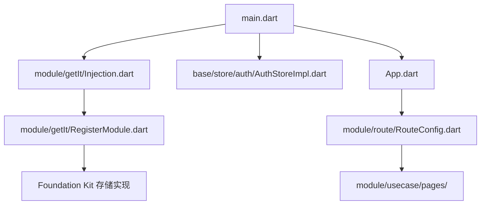

# lib 目录说明

`lib` 是 example 工程的应用入口和示例代码目录，用于展示 `flutter_foundation_kit` 在 Flutter 应用中的接入方式。这里的代码按职责分层：模块页面放在 `module/usecase`，接口抽象放在 `base/port`，实现放在 `infra`，依赖注册放在 `module/getIt`，路由放在 `module/route`，公共 UI 放在 `e_uikit`。

## 应用入口和目录职责

- [main.dart](main.dart) 初始化 Flutter 和 GetIt，并根据认证状态选择登录页或首页。
- [App.dart](App.dart) 使用 `MaterialApp.router` 挂载路由配置。
- [base/](base/README.md) 包含 [示例网络 API](base/api/README.md) 和 [认证、用户、设置 Store](base/store/README.md)。[base/port/](base/port/README.md) 预留给应用端口接口。
- [module/](module/README.md) 包含 `usecase/pages/` 下的示例页面和状态编排，以及 [GetIt 依赖注册](module/getIt/README.md) 和 [路由配置](module/route/README.md)。
- [infra/](infra/README.md) 预留给应用端口的具体实现。
- [e_uikit/](e_uikit/README.md) 预留给跨模块共享的 Widget 和样式组件。

## 启动与依赖装配

## 推荐依赖方向

模块层通过 `base/port` 中定义的接口使用第三方能力，不直接依赖第三方 SDK。`infra` 负责实现这些接口，并通过 `module/getIt` 注册给上层使用。这样模块只关心业务语义，第三方 SDK 的初始化、参数转换和平台差异都收敛在基础设施层。
